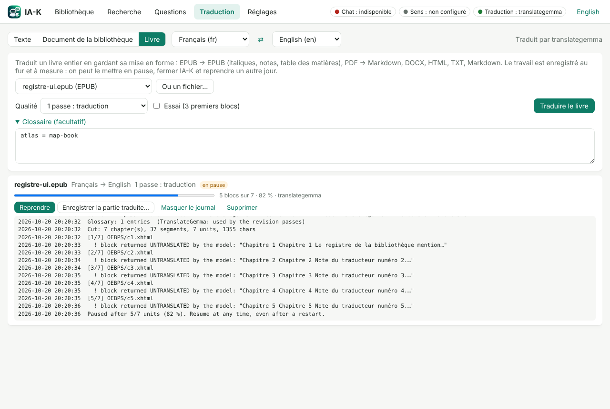

# IA-K en bref

IA-K est un assistant documentaire **personnel, hors ligne et portable**. Il
lit vos documents, les rend interrogeables par mots ou par sens, répond à vos
questions en citant ses sources, et traduit textes et livres entiers. Tout se
passe sur votre ordinateur, avec des modèles de langue locaux : aucun document
ne part sur Internet.

[Guide complet (en anglais) : README.md](README.md)

## Où et comment il fonctionne

- **Portable** : IA-K tient dans un dossier, sur une clé USB ou un disque, et
  fonctionne sous **Windows, Linux et macOS**, y compris depuis la même clé
  exFAT, avec une bibliothèque commune.
- **Sans installation sur l'ordinateur** : un Python complet est installé sur
  la clé (`setup_python`), une fois par système.
- **Modèles locaux** au format GGUF, servis par llama.cpp (`llama-server`) :
  Gemma 4 pour les réponses, EmbeddingGemma pour la recherche par le sens,
  TranslateGemma pour la traduction, Qwen3-VL pour la lecture des pages.
- **Un fichier par usage** lance les serveurs nécessaires puis IA-K, et les
  arrête à la fermeture : `serveurs-baseConnaissance` (questions),
  `serveurs-traduction`, `serveurs-vl` (relecture des scans).
- **Plusieurs ordinateurs** : chaque ordinateur a sa section de réglages,
  choisie par son nom ; la même clé sert partout.
- Interface en **français et en anglais**. Logiciel libre, licence MIT.

## Bibliothèque

- Import de **PDF, scans, images, captures d'écran, EPUB, DOCX, HTML, TXT et
  Markdown**, par bouton ou glisser-déposer ; copie dans la bibliothèque ou
  simple référence au fichier.
- **OCR** (Tesseract) des pages scannées, avec la confiance de lecture de
  chaque page ; langues réglables (`fra+eng`, `fra+frm` pour le moyen
  français…).
- Visionneuse : la page à gauche, son texte à droite, **correction du texte**
  conservée même après une nouvelle extraction.
- Sauvegarde automatique de la base avant chaque suppression ou mise à jour ;
  les fichiers d'origine ne sont jamais modifiés.

## Recherche et questions

- **Recherche par mots, par sens ou les deux** : « Qui est Geoffroy Martel ? » trouve « C’est le fils de Foulques Nerra, il est né en 1005 … ».
- **Réponses sourcées** : chaque affirmation renvoie au document, à la page
  et au passage ; un clic ouvre la page et **surligne le passage**.
- Réponse écrite en direct ; **questions de suivi** (« et quand l'a-t-il
  rendu ? ») ; filtres par type ou par document.
- Si les documents ne contiennent pas la réponse, IA-K **le dit** au lieu
  d'inventer.
- **Export en Markdown** : « Copier en Markdown » sur chaque réponse,
  « Exporter la conversation… » pour toute la séance ; chaque réponse garde
  ses renvois [S1] et la liste de ses sources (document, page, extrait du
  passage).

## Analyses

- Analyse d'une page par le modèle de vision : décrire, transcrire, expliquer
  une erreur sur une capture d'écran, extraire noms, dates et montants,
  répondre à une question.
- **Résumé** d'un document avec renvoi aux pages ; **comparaison** de
  plusieurs documents (points communs, différences, contradictions).
- Résumés, comparaisons et analyses se **copient ou s'exportent en
  Markdown** : pages citées, documents comparés (D1, D2…), modèle et date.

## Relecture des scans difficiles

- Le modèle de vision **corrige le texte de Tesseract** à partir de l'image,
  ou relit l'image seule : livres anciens, colonnes, tableaux (rendus en
  Markdown).
- Chaque lecture est une **proposition** : taux de concordance avec le texte
  actuel, **différences mot à mot**, puis « Utiliser comme texte de la page »
  ou retour au texte extrait.
- Relecture d'un **document entier** (pages faibles, toutes les pages OCR ou
  toutes les pages), en remplaçant directement si on le souhaite, sans jamais
  toucher aux pages corrigées à la main ; annulable et reprise là où elle
  s'est arrêtée.

## Traduction

- **Texte libre** : coller un texte, choisir les langues (ou détection
  automatique), traduire ; 18 langues proposées, dont le latin, l'occitan
  et le breton.
- **Document de la bibliothèque, page par page** : traductions conservées,
  pages corrigées depuis signalées, export Markdown ou texte (avec
  l'original si souhaité).
- **Livre entier, mise en forme conservée** : EPUB → EPUB (italiques, notes,
  liens, table des matières), PDF → Markdown (titres, paragraphes recollés,
  en-têtes et numéros de page retirés), DOCX, HTML, TXT, Markdown.
  - 1 à 3 passes : traduction, révision bilingue, relecture finale ;
  - glossaire facultatif (« terme = traduction ») ;
  - essai sur les premiers blocs ;
  - **pause et reprise**, même après l'arrêt de l'ordinateur ;
  - le livre traduit peut être enregistré ou ajouté à la bibliothèque.
- TranslateGemma est utilisé quand son serveur tourne (avec sa consigne
  d'entraînement exacte), sinon le modèle de chat traduit.

## Pour aller plus loin

- **Ligne de commande** (`iak.bat`, `./iak.sh`) pour tout faire sans
  l'interface : import, recherche, questions, résumés, relecture, traduction
  de livres ([BACKEND.md](BACKEND.md)).
- **API locale** sécurisée (127.0.0.1, jeton) utilisée par l'interface.
- Serveurs de modèles : réglages, mémoire graphique, mesures
  ([SERVERS.md](SERVERS.md)) ; développement et intégration continue
  ([DEVELOPERS.md](DEVELOPERS.md)).
