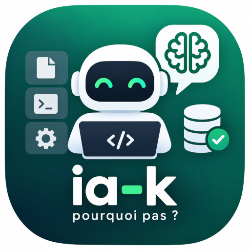

# IA-K



IA-K is a personal, offline desktop assistant for your documents. Give it
PDF files, scans, screenshots, EPUB, HTML, DOCX, TXT or Markdown: it reads
them (with OCR when needed), lets you search them by words or by meaning, and
answers questions about them with **sourced answers** that point to the
document, the page and the passage. It also translates texts and whole
documents with TranslateGemma.

- **Offline and private.** Everything runs on your computer with local
  language models; no document is sent anywhere.
- **Portable.** IA-K lives on a USB key or a disk folder and runs on
  Windows, Linux and macOS, from the same exFAT key if you like.
- **French and English** interface.
- Open source, MIT licence.

Other guides: [FONCTIONNALITES.md](FONCTIONNALITES.md) (the features in
brief, in French), [SERVERS.md](SERVERS.md) (running the language models
with llama.cpp), [BACKEND.md](BACKEND.md) (command line, how documents are
handled, local API), [DEVELOPERS.md](DEVELOPERS.md) (building, tests,
architecture).

## What you need

- A Windows 10/11 or Linux computer (x86-64), or a Mac (macOS 11 or later,
  Apple silicon or Intel). The reference machine is a laptop with a Ryzen AI
  9 HX 370, its Radeon 890M and 32 GB of memory.
- **Language model servers** on that computer (or on your network):
  [llama.cpp](https://github.com/ggml-org/llama.cpp) `llama-server` with
  Gemma 4 for answers and EmbeddingGemma for search by meaning. IA-K does
  not start them; [SERVERS.md](SERVERS.md) explains how, with ready-made
  launchers.
- Nothing else for scans and images: the zips carry
  [Tesseract](https://github.com/tesseract-ocr/tesseract) with French,
  English, Middle French and Latin. On an Intel Mac, which it does not cover
  yet, install it with `brew install tesseract tesseract-lang`
  ([Homebrew](https://brew.sh)); a Tesseract installed on the computer is
  used too when the key has none. Without any, documents with real text
  still work.
- About 260 MB on the key for each system (application, its Python and its
  Tesseract) and 65 MB of language data shared by all, plus your
  documents.

## Installing on a key or a disk

1. **Get IA-K and unzip it.** Download `ia-k.zip`, the key for all
   systems, or only `ia-k-windows.zip`, `ia-k-linux.zip` or `ia-k-mac.zip`
   (GitHub, *Actions* tab, last successful *CI* run, *Artifacts*), or build
   it ([DEVELOPERS.md](DEVELOPERS.md)). Unzip it at the root of the key, for
   instance `E:\ia-k`, `/media/me/KEY/ia-k` or `/Volumes/KEY/ia-k`. Each zip
   holds the application and its engine with their own Python: nothing else
   to install, nothing written on the computer. Zips of several systems can
   be unzipped in the same folder: the systems then share the library.

   On macOS, IA-K is not signed by an identified developer: before the first
   start, run once in the Terminal `xattr -dr com.apple.quarantine
   /Volumes/KEY/ia-k` (your folder), or right-click `IA-K.app` → *Open*.
2. **Intel Mac only**: the zip holds the Python of Apple silicon Macs. Run
   once, in the Terminal, `./setup_python.sh` (needs internet): it adds the
   Intel one next to it in `build/python/`, so the key then serves both.
   The same script (`setup_python.bat` on Windows) updates the Python of a
   key, or installs it in a folder built from the sources; it can be run
   again safely.
3. **Say where the model servers are.** With the usual ports (chat 8080,
   meaning 8081, vision 8082, translation 8083) there is nothing to do.
   Otherwise fill in *Settings*, or copy `config/servers.example.toml` to
   `config/servers.toml` and edit it. Each computer gets its own section,
   chosen by its name, so one key works on several computers.
4. **Start the model servers, then IA-K.** One file does both, and stops
   the servers when IA-K is closed:
   - `serveurs-baseConnaissance.bat` (Linux: `./serveurs-baseConnaissance.sh`):
     Gemma 4 26B-A4B and EmbeddingGemma, for the library, search and
     questions;
   - `serveurs-traduction.bat` (`./serveurs-traduction.sh`): TranslateGemma
     and EmbeddingGemma, for translation;
   - `serveurs-vl.bat` (`./serveurs-vl.sh`): Qwen3-VL-8B and EmbeddingGemma,
     to read difficult scans again (below).

   Their settings (where llama.cpp and the models are, memory options) are
   those of the reference laptop, in `server/local.hx370.bat`; on another
   computer copy it to `server/local.bat` and edit the copy
   ([SERVERS.md](SERVERS.md#starting-them)); on Linux and macOS, `server/local.sh`.
   IA-K alone is `ia-k.exe`, `./ia-k` on Linux, `IA-K.app` on macOS.

The folder then looks like this:

```
ia-k/
├── ia-k.exe  ia-k  IA-K.app the application (Windows, Linux, macOS)
├── backend/                 the engine (Python), started by the application
├── build/python/            portable Python, one folder per system (two for Macs)
├── config/servers.toml      where the model servers are, per computer
├── data/                    your library: database, copies of your files, backups
├── server/                  launchers for the model servers, their settings
├── serveurs-*.bat  *.sh     model servers + IA-K in one go
└── setup_python.*  iak.*    setup, and the command line (BACKEND.md)
```

The library can be moved elsewhere (a disk, a bigger key) from *Settings*.

## Using IA-K

**Library.** *Import files…* or drop files on the window. They are copied
into the library (or only referenced, if you tick the box), read, cut into
passages and indexed; scanned pages go through OCR. The list shows each
document's state, pages, OCR pages and passages; the *Jobs* panel shows
imports and analyses in progress. From the list you can open, summarise or
delete a document, and compare the documents you tick.

**Folders.** *Import a folder…* (or drop a folder on the window) brings in
all the documents of a folder and its subfolders, in a collection named
after it. By default the files are only referenced: they stay where they
are, IA-K keeps their text, pages and analyses. A *watched* folder is looked
at every minute while IA-K runs: files added or changed there are imported
by themselves (a changed file replaces its document, unless you corrected
it). A file deleted from the folder leaves its document in the library. A
folder on the key that holds IA-K is found again on another computer,
whatever its drive letter; one that is not on this computer is simply
skipped. *Look now*, *Stop watching* and *Stop following* are in the list of
folders.

**Collections.** Group documents by subject, project or source: tick
documents, *+ New collection* (or *Add to the collection* for an existing
one). A document can be in several collections; the chips above the list
show one collection at a time, where documents can be removed from it or
moved to another one (*Move to the collection*), and the collection renamed
or deleted (its documents stay in the library). In the viewer, the
*Collections* chips of a document put it in or take it out of each one. In
*Search* and *Questions*, a collection limits the passages to its documents,
alone or with a type or a document.

**Document.** The page on the left, its text on the right. OCR text can be
corrected and saved; the correction is kept even if the document is read
again. *Analyse the page* asks the model to describe it, transcribe it,
explain an error on a screenshot, extract names, dates and amounts, or answer
a question of yours. When you arrive from a search or a citation, the passage
is highlighted in yellow on the page.

**Full text.** *Full text…* in the viewer makes, from a scanned PDF (or an
image, or a PDF with an OCR layer), a light document of real text an e-reader
can reflow: the library's text (OCR, your corrections, the vision model's
readings) replaces the pictures of the pages, headings are found from the
size of the letters, running heads and page numbers go, the paragraphs are
rebuilt from the page as a reader sees them (an indented first line, a short
last line, extra space; not every line Tesseract found misaligned) and joined
across pages, the notes at the foot of the pages are linked to their calls
(*link the notes*: footnotes on EPUB readers, linked notes in HTML, a list at
the end of each chapter elsewhere), and the illustrations (photographs,
engravings, maps) are cut out of the pages and kept in place. As EPUB, or PDF on A5 pages, HTML, Word,
RTF or Markdown, much lighter than the scan (how much depends on the
illustrations kept).
For an EPUB made of pictures of scanned pages, each picture of text is read
and replaced by its text; illustrations and the cover stay. *Tesseract,
then targeted vision on the doubtful words* is the best compromise: Tesseract
reads every page, and the vision model (`serveurs-vl.bat`) reads again only
the lines that hold doubtful words; *Tesseract, then the text model* uses the
chat server instead (`serveurs-baseConnaissance.bat`); Tesseract alone needs
no server. In every case the elisions OCR misses are put right (`quon`,
`Lanxiété` → `qu'on`, `L'anxiété`), the notes are linked to their calls, and
the corrections made and refused are listed in a `.corrections.tsv` file next
to the book. The result can be saved, or added to the library.

**Reading pages again.** When Tesseract reads a scan badly (old print,
columns, tables, handwriting), the vision model can do better. In *Analyse
the page*, *Correct the OCR text from the image* gives it the page and
Tesseract's text to correct; *Transcribe* has it read the image alone. The
reading is shown with its agreement with the page's text: a low figure on a
page Tesseract read well is a reason to look at *Differences* (word by word)
before *Use as the page's text*. Nothing is replaced until you choose to, and
*Restore the extracted text* goes back. *Read pages again…* does it for a whole
document: the poor OCR pages (confidence below 80 %), every OCR page or every
page, proposing readings or replacing the text directly — never on pages you
corrected by hand.

**Doubtful words.** Under the text of an OCR page, *Doubtful words* lists the
words Tesseract was unsure of, that the library does not know (its own
vocabulary: the books' spellings, old French included; add word lists in
`config/words/`), or whose letters look like an OCR slip (`at1as`, `aTlas`).
A click selects the word in the text and frames it on the page; *show them
on the page* frames them all. Pages with many of them have an orange dot in
the list. Two ways correct only those words, much faster than reading the
whole page again: *Fix the doubtful words (text model)* gives each one, in
its sentence and with the close words of your books, to the chat model;
*Read the doubtful words again on the image (targeted vision)* cuts out the
lines that hold them and has the vision model read them. Each proposed word
is checked (a word of the library, or a few letters away from the OCR's) and
the reading lists the words corrected and the proposals refused; like the
other readings it is a proposal, with its differences. *Read pages again…*
can take the pages with doubtful words, and correct them either way. Pages already read are not read again, so a cancelled run
goes on where it stopped. Pages whose text comes from the model are marked
·VL in the list. Best with Qwen3-VL-8B (`serveurs-vl.bat`); Gemma 4 with its
vision projector works too.

**Search.** Type words or a question. *Automatic* combines words and meaning:
"who repaired the damaged map?" finds "the binder mended the atlas spoilt by
damp" without any common word. Results can be limited to a type of document
or to one document; click one to open its page.

**Questions.** Ask in plain language. The answer is written as you watch,
with citations `[S1]` you can click; *Sources* lists them. You can follow up
("and when did he return it?"): the last exchanges are taken into account
until *New conversation*. When the documents do not contain the answer, IA-K
says so instead of inventing one. Questions can be limited to a type or a
document.

**Exports.** Every answer has *Copy as Markdown*, and *Export the
conversation…* saves all of it in a Markdown file: each question, its answer
with its `[S1]` marks, and under it the sources — document, page and the
passage quoted. Summaries, comparisons and page analyses have *Copy* and
*Export…* too: a summary lists the pages it cites, a comparison says which
documents D1, D2… are. Markdown opens in any text editor, Obsidian, Typora,
or converts to Word or PDF (Pandoc).

**Translation.** *Text*: paste a text, choose the languages (or let IA-K
detect the source language), *Translate*. *Library document*: choose a
document, *Translate the document*; it is translated page by page (or
section by section) and the translations are kept, so a long document can be
translated in several sittings, a page re-translated on its own, and the
pages whose text you corrected since are marked. *Export…* writes the
translation to a Markdown or text file, with the original if you like. In
the viewer, *Translate the page* does it for the page shown. Translation uses
TranslateGemma when its server runs, and otherwise the chat model.

*Book* translates a whole book and keeps its layout: an EPUB comes back as
an EPUB with its italics, notes, links and table of contents; DOCX and HTML
files in their own format. A PDF (headings found from the font sizes,
running heads and page numbers removed, paragraphs joined across pages;
pages read by OCR in the library are taken from there) comes back as a PDF
laid out on A5 pages, the size of an e-reader, or, as you choose, as EPUB,
HTML, Word, RTF, Markdown or text; so do scans, text and Markdown files. A
finished translation can be saved again in another of these formats, without
translating anything again. Choose a library document or a file, the languages and the quality
(1 pass, 2 with a revision, 3 with a final proofreading), and optionally a
glossary (`term = translation` per line). Paragraphs are sent in groups so
the model keeps the context. Everything translated is saved at once: *Pause*,
close IA-K, shut the computer down, and *Resume* another day where it
stopped. A *Trial* translates the first three blocks to check the result
first. When it is done, *Save as…*, or *Add to the library* to search the
translation. A long book takes hours, a night with two passes: the log
shows the time left.
**Settings.** The model servers of this computer, an API key if your servers
need one, the OCR languages (`fra+eng`, `fra+frm` for Middle French…), the
library folder.

Good to know:

- **Speed.** On the reference laptop with Gemma 4 26B-A4B, an answer starts
  after about 10 to 20 seconds and is written at 15 to 19 words per second;
  an image analysis takes 15 to 30 seconds. Importing a scanned book takes
  about a second per page for OCR.
- **One big model at a time** on a 32 GB laptop: the 26B (answers) and
  TranslateGemma 12B (translation) do not fit in graphics memory together;
  switch with the `serveurs-*` files.
- **Remote servers.** If the chat server is not on this computer, a banner
  says that passages of your documents leave it.
- **Backups.** The database is backed up in `data/backups/` before each
  deletion or upgrade. Your original files are never modified.

## When something goes wrong

| What you see | What to do |
|---|---|
| "This library is already open in another IA-K window" | Two IA-K were started (two `serveurs-…` files, for instance): use the window already open, or close it and click *Try again*. |
| "The library is busy (database is locked)" | Another program writes in the library: another IA-K on it (see above), or a long command line import. Wait a moment and do it again. |
| "The IA-K engine could not start" | Read `data/iak-backend.log`; if `build/python/` has no folder for this system (an Intel Mac, a folder built from the sources), run `setup_python` once. |
| Chat, Meaning or Translation shown in red at the top | The model server is not running or not at that address: start it, check *Settings*. |
| An error mentioning `ErrorOutOfDeviceMemory` or "graphics memory" | The model server ran out of graphics memory: see [SERVERS.md, Memory](SERVERS.md#memory). |
| "The documents do not allow an answer" | Nothing relevant was found: rephrase, check the document is indexed, or try *Search* first. |
| Scans give no text | Tesseract is missing or lacks the language: *Settings* shows which Tesseract is used and its languages (on the key: `fra`, `eng`, `frm`, `lat`). |
| Linux key: "cannot run, mounted noexec" | Remount the key with the `exec` option. |
| macOS: "IA-K cannot be opened" or "is damaged" | The download is quarantined: `xattr -dr com.apple.quarantine` on the IA-K folder, then open it again. |

## Licences

IA-K's own code is under the MIT licence. It uses PyMuPDF, under AGPL-3.0:
a distributed build of IA-K that includes it falls under the AGPL terms,
while the source stays MIT. Language models are not part of IA-K and keep
their own licences (Gemma terms of use, Apache 2.0 for Qwen).

## Roadmap

Done:

1. Feasibility study, model servers and their configuration
2. Backend: import, text extraction, OCR, storage, passages, citations by page
3. Full-text search and sourced answers
4. Search by meaning (EmbeddingGemma) and hybrid search
5. Document chat, follow-up questions, image analysis, summaries, comparisons
6. Desktop interface (Tauri 2): library, viewer with highlights, search,
   questions, settings
7. Windows and Linux builds by CI, portable zip, Linux and Windows on the
   same exFAT key
8. Translation tab with [TranslateGemma](https://huggingface.co/google/translategemma-12b-it):
   a text, a page or a whole document of the library, kept and exportable;
   launchers that start the servers of a use and IA-K together
9. Translation of whole books (EPUB, PDF, DOCX, HTML, TXT, Markdown) as in
   [truchement](https://github.com/fhoudebert/transcribe): paragraph groups
   sized to the server's context, revision passes, layout, notes and table
   of contents kept, glossary, resumable after a pause or a shutdown
10. [Qwen3-VL-8B](https://huggingface.co/lmstudio-community/Qwen3-VL-8B-Instruct-GGUF)
    as dedicated vision model (`serveurs-vl.bat`): difficult scans and tables
    read again to correct or replace Tesseract's text, page by page or for a
    whole document, with agreement, differences and going back

11. macOS: `ia-k-mac` zip in the *Actions* tab (*Artifacts*), one
    application for Apple silicon and Intel, `setup_python.sh` for macOS,
    engine tests on macOS in CI

12. Export of answers, conversations, summaries, comparisons and page
    analyses as Markdown, with their sources

13. Collections (named groups of documents) to limit search and questions

14. Folders: a whole folder referenced (or copied) as a collection named
    after it; watched folders, whose new or changed files are imported by
    themselves

15. Documents in full text: the pictures of text of a scanned PDF or EPUB
    replaced by their text, illustrations kept, as a light EPUB (or PDF,
    HTML, Word, RTF, Markdown)

16. The engine on the key: each zip holds its Python with the engine's
    packages (without test suites, caches or Tk), checked in CI by importing
    the engine with it; `ia-k.zip` merges the three systems into one key.
    No `setup_python` step, except on an Intel Mac

17. Tesseract on the key: built from its sources by CI, as one program per
    system with nothing to install, and the standard language data for
    French, English, Middle French and Latin, shared by all systems

Next:

- More languages for Tesseract on the key, chosen when building it.

Later:

- Other launchers by use, as needed.
