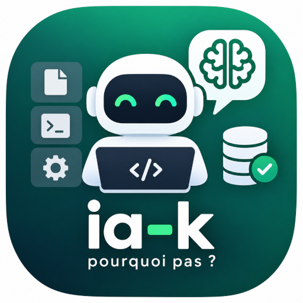

# IA-K

*[English version](README.md)*



IA-K est un assistant personnel et hors ligne pour vos documents. Donnez-lui
des PDF, des scans, des captures d'écran, des EPUB, HTML, DOCX, TXT ou
Markdown : il les lit (avec OCR si besoin), permet d'y chercher par mots ou
par sens, et répond à vos questions par des **réponses sourcées** qui
renvoient au document, à la page et au passage. Il traduit aussi des textes
et des documents entiers avec TranslateGemma.

- **Hors ligne et privé.** Tout tourne sur votre ordinateur avec des modèles
  de langue locaux ; aucun document n'est envoyé nulle part.
- **Portable.** IA-K tient sur une clé USB ou dans un dossier d'un disque et
  fonctionne sous Windows, Linux et macOS, depuis la même clé exFAT si vous
  le souhaitez.
- Interface en **français et en anglais**.
- Logiciel libre, licence MIT.

## Deux usages où IA-K excelle

- **Traduire un livre entier avec soin, grâce à un modèle local.** Une
  bonne traduction ne se fait pas d'un seul jet, et IA-K procède par
  étapes : un essai sur les premiers blocs pour juger du ton, un glossaire
  facultatif pour que noms et termes restent les mêmes du début à la fin,
  puis jusqu'à trois passes (traduction, révision bilingue face à
  l'original, relecture finale). La mise en forme est conservée (EPUB,
  DOCX, HTML, PDF au format A5), et une traduction de plusieurs heures se
  met en pause et reprend, même après l'arrêt de l'ordinateur. Aucune page
  du livre ne quitte votre ordinateur.
- **Obtenir le texte intégral d'un livre scanné, avec peu de relecture.**
  Chaque page est lue par Tesseract, comparée à la couche OCR du PDF quand
  il en a une, et seuls les mots douteux vont au modèle de vision, qui ne
  relit que ces lignes dans l'image. Le livre entier est ensuite fini :
  paragraphes et notes reconstitués, mots coupés recollés, typographie
  française, s long et orthographe ancienne pour les imprimés anciens.
  Chaque correction est listée dans un fichier `.corrections.tsv` : on sait
  ce qui reste à relire, et les pages corrigées à la main ne sont jamais
  écrasées.

Autres guides : [FONCTIONNALITES.md](FONCTIONNALITES.md) (ce que fait IA-K
et comment s'en servir). En anglais : [SERVERS.md](SERVERS.md) (faire
tourner les modèles de langue avec llama.cpp), [BACKEND.md](BACKEND.md)
(ligne de commande, traitement des documents, API locale) ; le
développement est décrit à part (voir [Développement](#développement)).

## Ce qu'il faut

- Un ordinateur sous Windows 10/11 (x86-64), sous Linux (x86-64 ou ARM
  64 bits), ou un Mac (macOS 11 ou plus récent, Apple silicon ou Intel).
  La machine de référence est un portable avec un Ryzen AI 9 HX 370, sa
  Radeon 890M et 32 Go de mémoire.
- Des **serveurs de modèles de langue** sur cet ordinateur (ou sur votre
  réseau) : `llama-server` de [llama.cpp](https://github.com/ggml-org/llama.cpp)
  avec Gemma 4 pour les réponses et EmbeddingGemma pour la recherche par le
  sens. IA-K ne les démarre pas lui-même ; [SERVERS.md](SERVERS.md) (en
  anglais) explique comment, avec des lanceurs tout prêts.
- Rien d'autre pour les scans et les images : les zips contiennent
  [Tesseract](https://github.com/tesseract-ocr/tesseract) avec le français,
  l'anglais, le moyen français et le latin. Sur un Mac Intel, pas encore
  couvert, installez-le avec `brew install tesseract tesseract-lang`
  ([Homebrew](https://brew.sh)) ; un Tesseract installé sur l'ordinateur
  sert aussi quand la clé n'en a pas. Sans aucun Tesseract, les documents
  qui contiennent du vrai texte fonctionnent quand même.
- Environ 260 Mo sur la clé par système (application, son Python et son
  Tesseract) et 65 Mo de données de langue communs à tous, plus vos
  documents.

## Installation sur une clé ou un disque

1. **Récupérer IA-K et le décompresser.** Téléchargez `ia-k.zip`, la clé
   pour tous les systèmes, ou seulement `ia-k-windows.zip`,
   `ia-k-linux.zip` (`ia-k-linux-arm64.zip` pour un Linux ARM) ou
   `ia-k-mac.zip` (sur GitHub, *Releases*, ou l'onglet *Actions*, dernière
   exécution réussie de *Release*, *Artifacts*), ou construisez-le
   ([DEVELOPERS.md](DEVELOPERS.md), en anglais). Décompressez-le à la
   racine de la clé, par exemple `E:\ia-k`, `/media/moi/CLE/ia-k` ou
   `/Volumes/CLE/ia-k`. Chaque zip contient l'application et son moteur
   avec leur propre Python : rien d'autre à installer, rien d'écrit sur
   l'ordinateur. Les zips de plusieurs systèmes peuvent être décompressés
   dans le même dossier : les systèmes partagent alors la bibliothèque.

   Sur macOS, IA-K n'est pas signé par un développeur identifié : avant le
   premier lancement, exécutez une fois dans le Terminal `xattr -dr
   com.apple.quarantine /Volumes/CLE/ia-k` (votre dossier), ou faites
   clic droit sur `IA-K.app` → *Ouvrir*.
2. **Mac Intel seulement** : le zip contient le Python des Mac Apple
   silicon. Exécutez une fois, dans le Terminal, `./setup_python.sh`
   (Internet nécessaire) : il ajoute à côté celui des Mac Intel dans
   `build/python/`, et la clé sert ensuite aux deux. Le même script
   (`setup_python.bat` sous Windows) met à jour le Python d'une clé, ou
   l'installe dans un dossier construit à partir des sources ; on peut le
   relancer sans risque.
3. **Indiquer où sont les serveurs de modèles.** Avec les ports habituels
   (chat 8080, sens 8081, vision 8082, traduction 8083), il n'y a rien à
   faire. Sinon remplissez les *Réglages*, ou copiez
   `config/servers.example.toml` en `config/servers.toml` et modifiez-le.
   Chaque ordinateur a sa propre section, choisie par son nom : une même
   clé fonctionne ainsi sur plusieurs ordinateurs.
4. **Lancer les serveurs de modèles, puis IA-K.** Un seul fichier fait les
   deux, et arrête les serveurs à la fermeture d'IA-K :
   - `serveurs-baseConnaissance.bat` (Linux : `./serveurs-baseConnaissance.sh`) :
     Gemma 4 26B-A4B et EmbeddingGemma, pour la bibliothèque, la recherche
     et les questions ;
   - `serveurs-traduction.bat` (`./serveurs-traduction.sh`) : TranslateGemma
     et EmbeddingGemma, pour la traduction ;
   - `serveurs-vl.bat` (`./serveurs-vl.sh`) : Qwen3-VL-8B et EmbeddingGemma,
     pour relire les scans difficiles (voir plus bas).

   Leurs réglages (emplacement de llama.cpp et des modèles, options de
   mémoire) sont ceux du portable de référence, dans
   `server/local.hx370.bat` ; sur un autre ordinateur, copiez-le en
   `server/local.bat` et modifiez la copie
   ([SERVERS.md](SERVERS.md#starting-them), en anglais) ; sous Linux et
   macOS, `server/local.sh`. IA-K seul, c'est `ia-k.exe`, `./ia-k` sous
   Linux (`./ia-k-arm64` sur ARM), `IA-K.app` sous macOS.

Le dossier ressemble alors à ceci :

```
ia-k/
├── ia-k.exe  ia-k  IA-K.app l'application (Windows, Linux, macOS ; ia-k-arm64 sur Linux ARM)
├── backend/                 le moteur (Python), lancé par l'application
├── build/python/            Python portable, un dossier par système et processeur
├── config/servers.toml      où sont les serveurs de modèles, par ordinateur
├── data/                    votre bibliothèque : base, copies de vos fichiers, sauvegardes
├── server/                  lanceurs des serveurs de modèles, leurs réglages
├── serveurs-*.bat  *.sh     serveurs de modèles + IA-K en une fois
└── setup_python.*  iak.*    installation, et la ligne de commande (BACKEND.md)
```

La bibliothèque peut être déplacée ailleurs (un disque, une clé plus
grande) depuis les *Réglages*.

## Utiliser IA-K

- **Bibliothèque** : importer des fichiers ou des dossiers entiers (un
  dossier surveillé importe tout seul ses nouveaux fichiers), les ranger en
  collections, corriger le texte de l'OCR dans la visionneuse.
- **Recherche et questions** : chercher par mots ou par sens ; poser des
  questions et obtenir des réponses qui citent le document, la page et le
  passage, exportables en Markdown.
- **Analyses** : une page décrite ou transcrite, des résumés, des
  comparaisons.
- **Texte intégral** : un PDF ou un EPUB scanné transformé en livre léger
  fait de vrai texte (paragraphes, notes, illustrations conservés), relu
  par Tesseract et vérifié avec la couche OCR du PDF et le modèle de
  vision, fini sur tout le livre (typographie française, mots coupés,
  s long, orthographe moderne), en EPUB, PDF, HTML, Word, RTF, Markdown ou
  pour Project Gutenberg.
- **Scans difficiles** : le modèle de vision relit des pages, ou seulement
  les mots douteux, sous forme de propositions que vous acceptez ou non.
- **Traduction** : un texte, un document page par page, ou un livre entier
  avec sa mise en forme, reprenable après une pause.
- **OCR rapide** : déposer une image sur l'onglet *Traduction* donne son
  texte en une seconde, avec Tesseract seul : ni serveur, ni import.

Tout, pas à pas : [FONCTIONNALITES.md](FONCTIONNALITES.md).

## En cas de problème

| Ce que vous voyez | Que faire |
|---|---|
| « Cette bibliothèque est déjà ouverte dans une autre fenêtre IA-K » | Deux IA-K ont été lancés (le programme deux fois, ou un fichier `serveurs-…` d'une version plus ancienne) : utilisez la fenêtre déjà ouverte, ou fermez-la et cliquez sur *Réessayer*. Un fichier `serveurs-…` lancé pendant qu'IA-K est ouvert ne fait qu'ajouter ses serveurs. |
| « La bibliothèque est occupée (base verrouillée) » | Un autre programme écrit dans la bibliothèque : un autre IA-K ouvert dessus (voir ci-dessus), ou un long import en ligne de commande. Attendez un instant et recommencez. |
| « Le moteur IA-K n'a pas pu démarrer » | Lisez `data/iak-backend.log` ; si `build/python/` n'a pas de dossier pour ce système (un Mac Intel, un dossier construit à partir des sources), lancez une fois `setup_python`. |
| Chat, Sens ou Traduction affiché en rouge en haut | Le serveur de modèle ne tourne pas ou n'est pas à cette adresse : démarrez-le, vérifiez les *Réglages*. |
| Une erreur qui mentionne `ErrorOutOfDeviceMemory` ou la « mémoire graphique » | Le serveur de modèle a manqué de mémoire graphique : voir [SERVERS.md, Memory](SERVERS.md#memory) (en anglais). |
| « Les documents ne permettent pas de répondre » | Rien de pertinent n'a été trouvé : reformulez, vérifiez que le document est indexé, ou essayez d'abord la *Recherche*. |
| Les scans ne donnent aucun texte | Tesseract manque ou n'a pas la langue : les *Réglages* indiquent quel Tesseract est utilisé et ses langues (sur la clé : `fra`, `eng`, `frm`, `lat`). |
| Clé sous Linux : « cannot run, mounted noexec » | Remontez la clé avec l'option `exec`. |
| macOS : « IA-K ne peut pas être ouvert » ou « est endommagé » | Le téléchargement est en quarantaine : `xattr -dr com.apple.quarantine` sur le dossier d'IA-K, puis rouvrez-le. |

## Développement

La construction d'IA-K à partir des sources, les tests et l'architecture
sont décrits en anglais dans [DEVELOPERS.md](DEVELOPERS.md) ; la ligne de
commande et l'API locale dans [BACKEND.md](BACKEND.md).

## Licences

Le code propre à IA-K est sous licence MIT. Il utilise PyMuPDF, sous
AGPL-3.0 : une version distribuée d'IA-K qui l'inclut relève des termes de
l'AGPL, tandis que les sources restent sous MIT. Les modèles de langue ne
font pas partie d'IA-K et gardent leurs propres licences (conditions
d'utilisation de Gemma, Apache 2.0 pour Qwen).
